<p align="center">
  
</p>

<p align="center">
  
  
  
</p>

# 📘 Ejercicios - Fase 1 (APE 4)

Repositorio con los ejercicios en **Java** correspondientes a la **Fase 1** de la **Actividad de Prácticas de Experimentación (APE 4)**.

---

## 📂 Organización del repositorio

```
EJERCICIOS-FASE1-APE4/
│
├── Ejercicio1.java
├── Ejercicio2.java
├── Ejercicio3.java
├── Ejercicio4.java
├── Ejercicio5.java
├── banner.svg
└── README.md
```

---

## 🧩 Contenido

| N.º | Archivo | Descripción |
|:---:|---------|-------------|
| 1 | `Ejercicio1.java` | Ejercicio 1 de la Fase 1 |
| 2 | `Ejercicio2.java` | Ejercicio 2 de la Fase 1 |
| 3 | `Ejercicio3.java` | Ejercicio 3 de la Fase 1 |
| 4 | `Ejercicio4.java` | Ejercicio 4 de la Fase 1 |
| 5 | `Ejercicio5.java` | Ejercicio 5 de la Fase 1 |

> ✏️ Puedes reemplazar la columna *Descripción* por el enunciado o el tema de cada ejercicio.

---
